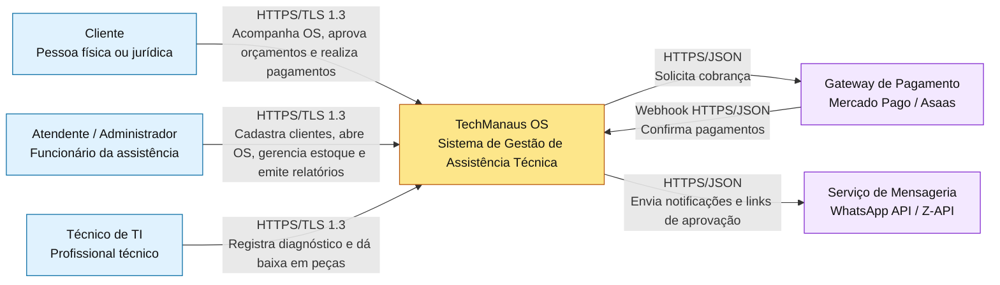
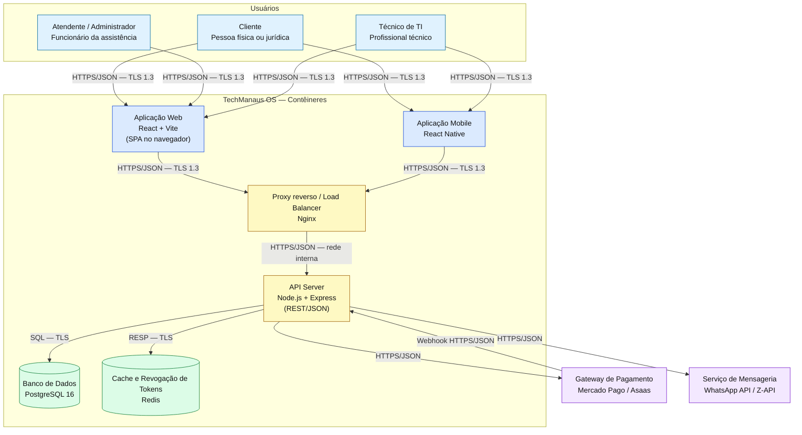
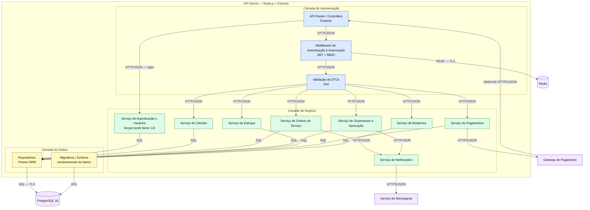
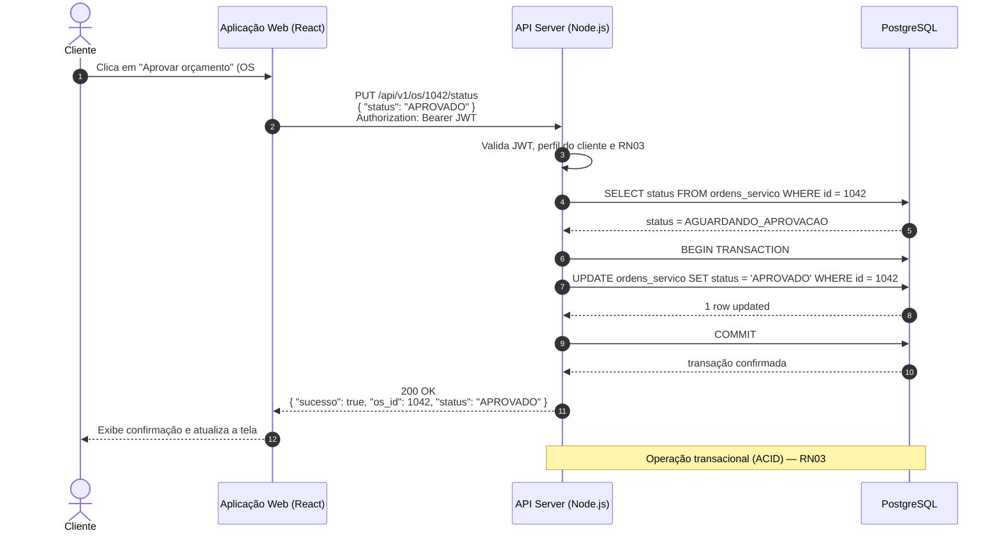

# Documentação de Requisitos e Arquitetura de Software

**Sistema:** TechManaus — Sistema de Gestão de Assistência Técnica de Informática  
**Instituição:** Centro Universitário de Ensino Superior do Amazonas (CIESA)  
**Disciplina:** Projetos de Sistemas  
**Trabalho:** Requisitos e Arquitetura de um Sistema — NP2

Este documento reúne o levantamento e a classificação de requisitos (Parte 1) e o documento de arquitetura cliente-servidor (Parte 2) do sistema **TechManaus OS**. Todos os diagramas estão escritos em Mermaid e são renderizados automaticamente pelo GitHub.

## Sumário

- [Parte 1 — Levantamento e Classificação de Requisitos](#parte-1--levantamento-e-classificação-de-requisitos)
  - [1.1 Descrição do Sistema](#11-descrição-do-sistema)
  - [1.2 Tabela Unificada de Requisitos](#12-tabela-unificada-de-requisitos)
- [Parte 2 — Documento de Arquitetura](#parte-2--documento-de-arquitetura)
  - [2.1 Diagramas C4 (Níveis 1 a 3)](#21-diagramas-c4-níveis-1-a-3)
  - [2.2 Registros de Decisão de Arquitetura (ADRs)](#22-registros-de-decisão-de-arquitetura-adrs)
  - [2.3 Comunicação Cliente-Servidor](#23-comunicação-cliente-servidor)
  - [2.4 Matriz de Rastreabilidade](#24-matriz-de-rastreabilidade)
- [Anexo — Checklist de Conformidade com o Enunciado](#anexo--checklist-de-conformidade-com-o-enunciado)

---

## Parte 1 — Levantamento e Classificação de Requisitos

### 1.1 Descrição do Sistema

O **TechManaus OS** é um sistema web e mobile desenvolvido para automatizar e otimizar os processos operacionais de uma assistência técnica de computadores e notebooks localizada em Manaus/AM. A plataforma permite o gerenciamento completo do ciclo de atendimento, desde a recepção do equipamento e abertura da Ordem de Serviço (OS) até o diagnóstico técnico, a aprovação do orçamento pelo cliente, o controle de peças em estoque e o faturamento final.

O sistema atende três perfis de usuário:

- **Cliente:** acompanha o status da OS, aprova ou rejeita orçamentos e realiza pagamentos online.
- **Técnico:** registra diagnósticos, informa as peças necessárias e atualiza os status das reparações.
- **Atendente / Administrador:** cadastra clientes, abre ordens de serviço, gerencia o estoque de peças e finaliza a entrega e o faturamento.

### 1.2 Tabela Unificada de Requisitos

| Código | Tipo | Descrição | Prioridade |
|---|---|---|---|
| RF01 | Funcional | O sistema deve permitir que o atendente cadastre novos clientes informando nome, CPF/CNPJ, telefone e e-mail. | Alta |
| RF02 | Funcional | O sistema deve permitir que o atendente abra e gerencie uma Ordem de Serviço (OS) associada a um cliente e um equipamento. | Alta |
| RF03 | Funcional | O sistema deve permitir que o técnico registre o diagnóstico técnico detalhado e a lista de peças/serviços necessários para a OS. | Alta |
| RF04 | Funcional | O sistema deve permitir que o cliente visualize o orçamento gerado para a sua Ordem de Serviço por meio de um link seguro. | Alta |
| RF05 | Funcional | O sistema deve permitir que o cliente aprove ou rejeite o orçamento enviado. | Alta |
| RF06 | Funcional | O sistema deve permitir que o administrador cadastre e atualize itens e quantidades no estoque de peças. | Média |
| RF07 | Funcional | O sistema deve permitir que o técnico dê baixa no estoque das peças utilizadas ao concluir um reparo. | Média |
| RF08 | Funcional | O sistema deve permitir que o cliente consulte o histórico de Ordens de Serviço vinculadas ao seu CPF. | Baixa |
| RF09 | Funcional | O sistema deve permitir que o atendente emita o comprovante de entrada/recebimento do equipamento em formato PDF. | Média |
| RF10 | Funcional | O sistema deve permitir que o administrador gere relatórios mensais de faturamento e serviços concluídos. | Média |
| RNF01 | Não funcional | A busca por cliente ou Ordem de Serviço deve responder em até 2,0 segundos sob carga normal de operação. | Alta |
| RNF02 | Não funcional | O sistema deve estar disponível 99,5% do tempo no regime de operação de 24h/7d. | Alta |
| RNF03 | Não funcional | Todas as comunicações entre o cliente e o servidor devem ser criptografadas utilizando HTTPS/TLS 1.3. | Alta |
| RNF04 | Não funcional | A interface web deve ser responsiva e adaptável a telas com resolução mínima de 360 px de largura (padrão WCAG 2.1 nível AA para acessibilidade). | Média |
| RNF05 | Não funcional | A API do servidor deve ser compatível com os navegadores Google Chrome (v100+), Mozilla Firefox (v100+) e Apple Safari (v15+). | Média |
| RNF06 | Não funcional | As senhas de usuários e tokens de acesso devem ser armazenados no banco de dados utilizando algoritmo de hash bcrypt com custo (work factor) mínimo de 12. | Alta |
| RN01 | Regra de negócio | O prazo de garantia legal para peças e serviços executados na assistência técnica é de 90 dias a contar da data de entrega do equipamento. | Alta |
| RN02 | Regra de negócio | Equipamentos deixados na assistência sem aprovação ou retirada por mais de 90 dias após notificação final estarão sujeitos a cobrança de taxa de custódia diária. | Média |
| RN03 | Regra de negócio | Nenhuma Ordem de Serviço pode iniciar a etapa de reparo/execução sem a aprovação prévia e formal do orçamento pelo cliente. | Alta |
| RN04 | Regra de negócio | O cancelamento de uma Ordem de Serviço aprovada após o início da substituição de peças incorre em taxa administrativa de 10% sobre o valor total do orçamento. | Média |
| RN05 | Regra de negócio | O valor total cobrado em uma Ordem de Serviço é composto pela soma do valor das peças utilizadas + valor da mão de obra cadastrada para o serviço. | Alta |

**Cobertura dos requisitos:** 10 requisitos funcionais (mínimo de 10), 6 requisitos não funcionais (mínimo de 6) e 5 regras de negócio (mínimo de 5). As categorias de RNF atendidas são: **desempenho** (RNF01), **disponibilidade** (RNF02), **segurança** (RNF03 e RNF06), **usabilidade/acessibilidade** (RNF04) e **compatibilidade** (RNF05) — cinco categorias, acima do mínimo de quatro.

---

## Parte 2 — Documento de Arquitetura

A arquitetura adotada é **cliente-servidor**, organizada em três níveis de abstração do modelo C4. O cliente web e o aplicativo mobile consomem uma API REST; a API concentra as regras de negócio e acessa o banco de dados relacional e os serviços externos.

### 2.1 Diagramas C4 (Níveis 1 a 3)

#### 2.1.1 Nível 1 — Contexto do Sistema

Mostra o TechManaus OS como uma única caixa, os três tipos de usuário identificados na Parte 1 e os dois sistemas externos com os quais o sistema conversa.



**Legenda:** os retângulos azuis representam os usuários/atores; o retângulo amarelo é o sistema TechManaus OS; os retângulos roxos são os sistemas externos. Cada seta informa o protocolo e o que trafega. Este nível não detalha contêineres internos nem banco de dados, pois isso é feito nos níveis 2 e 3.

#### 2.1.2 Nível 2 — Contêineres

Mostra as partes que rodam separadamente, com a tecnologia escolhida para cada contêiner e o protocolo de cada comunicação.



**Legenda:** cada contêiner informa a tecnologia entre parênteses; cada seta informa o protocolo e o formato dos dados. A **Aplicação Web** e a **Aplicação Mobile** são os clientes; o **API Server** concentra a lógica de negócio; o **PostgreSQL** persiste os dados; o **Redis** apoia a revogação de tokens JWT; o **Nginx** atua como proxy reverso e balanceador. O gateway de pagamento e o serviço de mensageria são sistemas externos. O nível 2 não detalha os módulos internos da API — isso é feito no nível 3.

#### 2.1.3 Nível 3 — Componentes (Interior da API REST)

Mostra o interior do contêiner **API Server**, com as camadas de apresentação, negócio e dados, além das integrações com os contêineres externos.



**Legenda:** o diagrama abre o contêiner **API Server**. As cores indicam as camadas: azul (apresentação), verde (negócio) e amarelo (dados). As setas mostram as chamadas internas entre controllers, middlewares, serviços e repositórios, além das integrações externas. O PostgreSQL, o Redis, o gateway de pagamento e o serviço de mensageria são contêineres ou sistemas externos à API.

### 2.2 Registros de Decisão de Arquitetura (ADRs)

#### ADR-001 — Adoção do PostgreSQL como banco de dados relacional

**Status:** Aceita  
**Data:** 2026-11-05  
**Requisitos relacionados:** RN03, RN05 e RNF01

##### Contexto

O sistema precisa armazenar e relacionar dados estritamente estruturados e financeiros (clientes, ordens de serviço, peças, valores, garantias e históricos). As regras de negócio **RN03** e **RN05** exigem consistência transacional total (ACID), pois qualquer inconsistência no estoque ou no cálculo final da OS resulta em perdas financeiras ou descumprimento de prazos. Além disso, o **RNF01** exige resposta em até 2,0 segundos, o que se beneficia de índices e consultas relacionais otimizadas.

##### Alternativas consideradas

###### Alternativa A — Banco de dados relacional (PostgreSQL)

- **A favor:** garantia de integridade referencial, suporte nativo a transações ACID e facilidade para consultas complexas envolvendo relacionamentos entre clientes, peças e ordens de serviço.
- **Contra:** menor flexibilidade para um schema extremamente dinâmico e necessidade de migrações estruturadas (*migrations*).

###### Alternativa B — Banco de dados não relacional (MongoDB)

- **A favor:** esquema flexível (documentos JSON) e escalabilidade horizontal simplificada.
- **Contra:** falta de garantias estritas de integridade referencial nativa entre coleções e maior complexidade para assegurar consistência em transações financeiras multinível.

##### Decisão

Escolhemos a **Alternativa A (PostgreSQL)**, porque o modelo relacional atende rigorosamente aos requisitos de integridade, confiabilidade e cálculo financeiro exigidos pelo negócio de assistência técnica, além de favorecer o desempenho das consultas exigidas pelo RNF01.

##### Consequências

- **Positivas:** consistência de dados garantida; facilidade no controle de saldo de estoque e no cálculo preciso da Ordem de Serviço; integridade referencial nativa; suporte a índices para consultas rápidas.
- **Negativas:** exige controle rigoroso e versionamento de esquemas de banco de dados por meio de migrações durante o desenvolvimento.

---

#### ADR-002 — Adoção de autenticação stateless com JWT

**Status:** Aceita  
**Data:** 2026-11-05  
**Requisitos relacionados:** RNF03 e RNF06

##### Contexto

O requisito **RNF03** exige tráfego seguro de informações e o **RNF06** determina padrões elevados de segurança para credenciais. Além disso, o sistema atende a perfis com níveis distintos de permissão (Cliente, Técnico e Administrador), acessando o sistema simultaneamente por navegadores e dispositivos móveis.

##### Alternativas consideradas

###### Alternativa A — Autenticação por token (JSON Web Token — JWT)

- **A favor:** arquitetura *stateless* (sem estado no servidor), facilitando a escalabilidade da API; alta compatibilidade com aplicações Single Page Application (React) e dispositivos móveis; fácil transporte no cabeçalho HTTP `Authorization: Bearer`.
- **Contra:** dificuldade de revogação imediata do token sem a implementação de uma *blacklist* baseada em memória (por exemplo, Redis).

###### Alternativa B — Autenticação baseada em sessão no servidor (Express-Session + Cookies)

- **A favor:** invalidação direta da sessão no lado do servidor a qualquer momento.
- **Contra:** exige armazenamento de estado (*stateful*) no servidor ou memória compartilhada, dificultando o dimensionamento horizontal da API.

##### Decisão

Escolhemos a **Alternativa A (JWT)**, porque viabiliza uma API totalmente *stateless*, permitindo consumo transparente tanto pelo cliente web quanto por futuros clientes nativos mobile. A revogação de tokens é tratada por uma *blacklist* no Redis, contêiner previsto no nível 2.

##### Consequências

- **Positivas:** API desacoplada e escalável; navegação fluida em aplicações React; controle de expiração nativo nos tokens; compatibilidade com o aplicativo mobile.
- **Negativas:** caso um token seja comprometido antes do tempo de expiração (`exp`), é necessário aguardar sua expiração natural ou consultar a lista de revogação mantida no Redis.

---

#### ADR-003 — Adoção de SPA com React.js para o cliente web

**Status:** Aceita  
**Data:** 2026-11-05  
**Requisitos relacionados:** RNF04 e RNF01

##### Contexto

O requisito **RNF04** estabelece a necessidade de uma interface responsiva, com navegação rápida para o cliente acompanhar orçamentos e para o técnico atualizar múltiplos status de ordens de serviço ao longo do dia com agilidade. O **RNF01** também é beneficiado por uma navegação que evita recarregamentos completos de página.

##### Alternativas consideradas

###### Alternativa A — Single Page Application (SPA com React.js)

- **A favor:** excelente experiência de usuário (UX) sem recarregamento de página; consumo assíncrono direto da API REST via JSON; interface rica para dashboards e formulários dinâmicos; componentes reutilizáveis e responsivos.
- **Contra:** tempo inicial de carregamento (*initial load*) um pouco mais alto e maior complexidade de gerenciamento de estado local.

###### Alternativa B — Server-Side Rendering tradicional (Node + EJS / HTML estático)

- **A favor:** renderização simples direto no servidor, com menor dependência de JavaScript no cliente.
- **Contra:** recarregamento completo da página a cada mudança de estado da OS, gerando navegação mais lenta e maior consumo de banda do servidor.

##### Decisão

Escolhemos a **Alternativa A (React.js — SPA)**, devido à alta interatividade necessária para os painéis de acompanhamento de Ordem de Serviço e para a gestão de estoque em tempo real.

##### Consequências

- **Positivas:** interface rápida e fluida sem recarregamentos; reutilização completa dos componentes de UI; desacoplamento total entre frontend e backend; melhor adaptação a diferentes tamanhos de tela.
- **Negativas:** necessidade de gerenciar o *build* do frontend separadamente da aplicação de API backend.

### 2.3 Comunicação Cliente-Servidor

#### 2.3.1 Diagrama de Sequência — Aprovação de Orçamento pelo Cliente

O fluxo abaixo descreve o caso de uso completo de aprovação de orçamento: o cliente acessa a aplicação web, a requisição chega à API, a API valida as regras, consulta e atualiza o banco de dados e devolve a resposta.



**Legenda:** o fluxo cobre os requisitos **RF04** e **RF05** e a regra **RN03**. As setas contínuas representam requisições; as tracejadas representam respostas. A aprovação só é permitida quando a OS está no estado `AGUARDANDO_APROVACAO`; a atualização é feita em transação para preservar a consistência dos dados e das regras de negócio.

#### 2.3.2 Especificação das Requisições HTTP

A tabela abaixo resume as quatro requisições especificadas. Elas cobrem os métodos **POST**, **GET**, **PUT** e **DELETE**, além de um cenário de erro **4xx**.

| # | Método | URL | Status de resposta | Requisito funcional |
|---|---|---|---|---|
| 1 | POST | `/api/v1/clientes` | `201 Created` | RF01 |
| 2 | GET | `/api/v1/os?cpf=123.456.789-00` | `200 OK` | RF08 |
| 3 | PUT | `/api/v1/os/1042/status` | `200 OK` | RF05 |
| 4 | DELETE | `/api/v1/os/9999` | `404 Not Found` | RF02 |

##### Requisição 1 — Criar cliente (POST) — sucesso

- **Método:** `POST`
- **URL:** `/api/v1/clientes`
- **Código de status:** `201 Created`
- **Corpo da requisição:**

```json
{
  "nome": "João Silva",
  "cpf": "123.456.789-00",
  "telefone": "(92) 99123-4567",
  "email": "joao.silva@email.com"
}
```

- **JSON de resposta:**

```json
{
  "sucesso": true,
  "mensagem": "Cliente cadastrado com sucesso.",
  "dados": {
    "id": 85,
    "nome": "João Silva",
    "cpf": "123.456.789-00",
    "telefone": "(92) 99123-4567",
    "email": "joao.silva@email.com",
    "criado_em": "2026-11-05T14:30:00Z"
  }
}
```

##### Requisição 2 — Consultar histórico de OS por CPF (GET) — sucesso

- **Método:** `GET`
- **URL:** `/api/v1/os?cpf=123.456.789-00`
- **Código de status:** `200 OK`
- **JSON de resposta:**

```json
{
  "sucesso": true,
  "total": 1,
  "dados": [
    {
      "os_id": 1042,
      "cliente_nome": "João Silva",
      "equipamento": "Notebook Dell Inspiron 15",
      "defeito_relatado": "Não liga e esquenta rápido",
      "status": "EM_ANALISE",
      "data_abertura": "2026-11-05T10:15:00Z"
    }
  ]
}
```

##### Requisição 3 — Atualizar status da OS (PUT) — sucesso

- **Método:** `PUT`
- **URL:** `/api/v1/os/1042/status`
- **Código de status:** `200 OK`
- **Corpo da requisição:**

```json
{
  "status": "APROVADO"
}
```

- **JSON de resposta:**

```json
{
  "sucesso": true,
  "mensagem": "Status da Ordem de Serviço atualizado.",
  "dados": {
    "os_id": 1042,
    "status_anterior": "AGUARDANDO_APROVACAO",
    "status_novo": "APROVADO",
    "atualizado_em": "2026-11-05T15:00:00Z"
  }
}
```

##### Requisição 4 — Cancelar OS inexistente (DELETE) — cenário de erro

- **Método:** `DELETE`
- **URL:** `/api/v1/os/9999`
- **Código de status:** `404 Not Found`
- **Corpo da requisição (opcional):**

```json
{
  "motivo": "Cancelamento solicitado pelo cliente"
}
```

- **JSON de resposta:**

```json
{
  "sucesso": false,
  "codigo_erro": "OS_NAO_ENCONTRADA",
  "mensagem": "A Ordem de Serviço informada (ID: 9999) não foi localizada no sistema."
}
```

#### 2.3.3 HTTPS e Protocolo TLS

Para garantir o cumprimento do requisito **RNF03**, todo o tráfego entre a aplicação web/mobile e os servidores backend utiliza **HTTPS sobre TLS 1.3**. As setas externas do diagrama de contêineres (nível 2) estão marcadas com o protocolo utilizado.

##### Dados que precisam de proteção

- Dados pessoais de clientes (CPF/CNPJ, e-mail, telefone e endereço).
- Credenciais de autenticação (senhas de usuários e tokens de acesso JWT).
- Informações de pagamentos e dados transacionais.
- Histórico de Ordens de Serviço, diagnósticos técnicos e valores de orçamento.

##### Garantias do TLS

- **Confidencialidade:** impede a interceptação de dados (*eavesdropping*) e ataques *Man-in-the-Middle* em redes públicas ou locais.
- **Integridade:** garante que a requisição e a resposta JSON não sejam modificadas durante o tráfego.
- **Autenticidade:** o certificado X.509 instalado no servidor assegura ao cliente que ele está se comunicando com o servidor oficial do sistema TechManaus.
- **Proteção contra downgrade:** o TLS 1.3 impede a negociação de versões ou algoritmos criptográficos obsoletos.

### 2.4 Matriz de Rastreabilidade

#### Matriz 1 — Requisito Não Funcional (RNF) ↔ Decisão de Arquitetura

| Código | Categoria | Elemento de arquitetura / decisão correspondente |
|---|---|---|
| RNF01 | Desempenho | **ADR-001** (PostgreSQL com índices) e **ADR-003** (SPA React, que evita recarregamentos completos); **API Server** no nível 2. |
| RNF02 | Disponibilidade | **API Server** desacoplado do banco e do Redis; **Proxy reverso / Load Balancer (Nginx)** no nível 2; PostgreSQL com backup e replicação. |
| RNF03 | Segurança | Seção **2.3.3** (HTTPS/TLS 1.3) e **ADR-002** (JWT); todas as setas externas do nível 2 usam HTTPS. |
| RNF04 | Usabilidade/Acessibilidade | **ADR-003** (SPA React responsiva) e contêiner **Aplicação Web** no nível 2; layout responsivo a partir de 360 px e diretrizes WCAG 2.1 AA. |
| RNF05 | Compatibilidade | Contêiner **Aplicação Web** (React + Vite) com *bundle* padronizado para Chrome 100+, Firefox 100+ e Safari 15+. |
| RNF06 | Segurança | **ADR-002** (JWT) + **Middleware de Autenticação e Autorização** e **Serviço de Autenticação e Usuários** (nível 3), com hash bcrypt de *work factor* 12. |

#### Matriz 2 — Requisição HTTP ↔ Requisito Funcional (RF)

| Requisição | Método / URL | Requisito funcional correspondente |
|---|---|---|
| 1 | `POST /api/v1/clientes` | **RF01** — cadastro de novos clientes. |
| 2 | `GET /api/v1/os?cpf=123.456.789-00` | **RF08** — consulta do histórico de Ordens de Serviço vinculadas ao CPF. |
| 3 | `PUT /api/v1/os/1042/status` | **RF05** — aprovação ou rejeição do orçamento pelo cliente (relacionado à RN03). |
| 4 | `DELETE /api/v1/os/9999` | **RF02** — gestão/cancelamento da Ordem de Serviço (cenário de erro 404, relacionado à RN04). |

#### Matriz 3 (complementar) — Regra de Negócio (RN) ↔ Elemento da Arquitetura

| Código | Elemento de arquitetura / decisão correspondente |
|---|---|
| RN01 | **Serviço de Ordens de Serviço** e tabela `ordens_servico` no PostgreSQL, com campo de data de entrega e controle do prazo de garantia. |
| RN02 | **Serviço de Ordens de Serviço** e **Serviço de Relatórios**, com cálculo da taxa de custódia diária após 90 dias. |
| RN03 | **Serviço de Orçamentos e Aprovação** e **Middleware de Autenticação**; o diagrama de sequência da seção 2.3.1 impede a mudança para `EM_REPARO` sem aprovação. |
| RN04 | **Serviço de Ordens de Serviço**, endpoint `DELETE /api/v1/os/{id}` e cálculo da taxa administrativa de 10% sobre o valor do orçamento. |
| RN05 | **Serviço de Ordens de Serviço** e tabelas de peças e mão de obra no PostgreSQL, com cálculo transacional do valor total da OS. |

**Critério de cobertura:** todos os RNF possuem ao menos uma decisão/elemento de arquitetura; todas as requisições HTTP estão associadas a um RF; todas as RN estão associadas a um elemento da arquitetura.

---

## Anexo — Checklist de Conformidade com o Enunciado

| Exigência do enunciado | Onde está atendida |
|---|---|
| Descrição do sistema com o negócio e os tipos de usuário | Seção **1.1** |
| Mínimo de 10 requisitos funcionais no formato “O sistema deve permitir que [usuário] [ação]” | Seção **1.2** — RF01 a RF10 |
| Mínimo de 6 requisitos não funcionais mensuráveis, cobrindo ao menos 4 categorias | Seção **1.2** — RNF01 a RNF06, em 5 categorias |
| Mínimo de 5 regras de negócio que valeriam sem o sistema | Seção **1.2** — RN01 a RN05 |
| Tabela de requisitos com código, descrição e prioridade | Seção **1.2** |
| Diagrama C4 nível 1 (contexto) com todos os usuários e ao menos 2 sistemas externos, setas legendadas | Seção **2.1.1** |
| Diagrama C4 nível 2 (contêineres) com cliente, servidor e banco, tecnologias e protocolos | Seção **2.1.2** |
| Diagrama C4 nível 3 (componentes) com as camadas de apresentação, negócio e dados | Seção **2.1.3** |
| Título e legenda em todos os diagramas, sem mistura de níveis | Seções **2.1.1**, **2.1.2**, **2.1.3** e **2.3.1** |
| Três ADRs no modelo do Anexo A, com duas alternativas, decisão, consequências positivas e negativas e vínculo com requisitos | Seção **2.2** — ADR-001, ADR-002 e ADR-003 |
| Diagrama de sequência Mermaid de um caso de uso completo (cliente → servidor → banco → resposta) | Seção **2.3.1** |
| Quatro requisições HTTP com método, URL, status e JSON, incluindo ao menos um erro 4xx | Seção **2.3.2** |
| Explicação dos dados protegidos e das garantias do TLS | Seção **2.3.3** |
| Matriz que liga cada RNF a uma decisão e cada requisição HTTP a um RF | Seção **2.4** — Matrizes 1 e 2 |
| Todos os diagramas em Mermaid, no próprio arquivo Markdown | Todo o documento |
